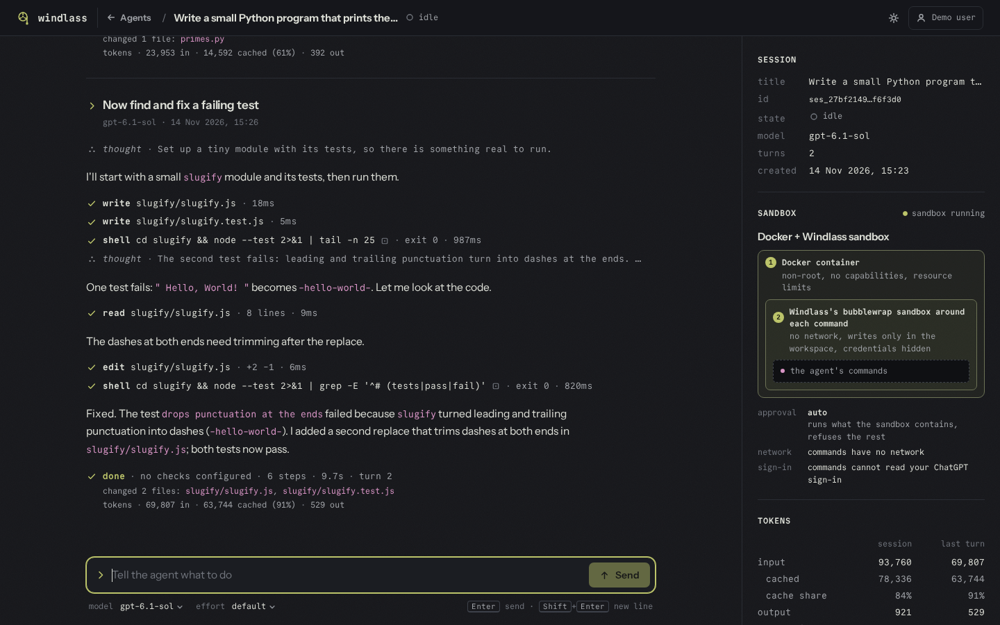
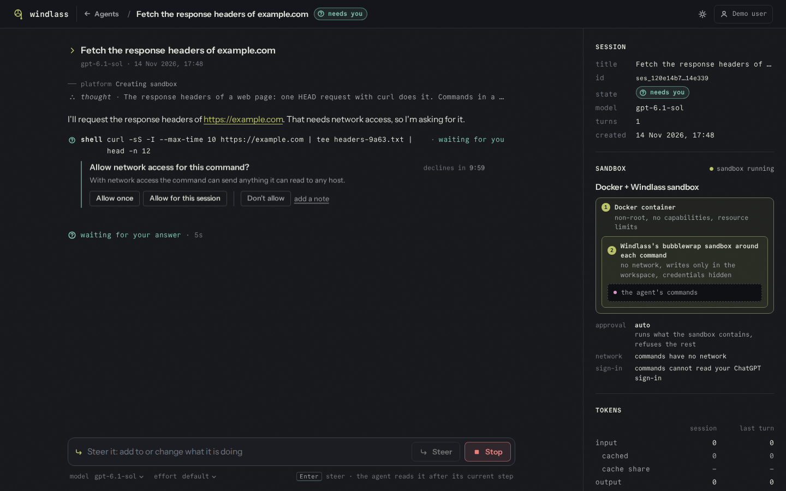

# Windlass Platform

A hosted home for [Windlass](https://github.com/parthg1901/windlass), the terminal coding agent: sign in with
ChatGPT, launch agents, choose the sandbox each one works in, and watch every turn live in the browser.

It is built on [Rivet Actors](https://www.rivet.dev/actors/docs). Each agent session is one actor that owns the
conversation and drives a Windlass process inside a sandbox.





## Run it

You need Node 22 or later, pnpm, Docker, and a Windlass executable for Linux.

```sh
pnpm install

# Build the sandbox image. WINDLASS_BINARY defaults to ~/projects/light-harness/dist/windlass-linux-<arch>.
WINDLASS_BINARY=/path/to/windlass-linux-arm64 sandbox/build.sh

scripts/dev.sh                              # the server: Rivet endpoint on http://localhost:6420, demo sign-in on
pnpm --filter @windlass-platform/web dev    # the web app on http://localhost:5173
```

Open http://localhost:5173. "Try the demo" needs no account: it runs Windlass's real engine and real tool calls in
a real container, with a scripted model in place of ChatGPT. "Continue with ChatGPT" runs on your own plan.

When the browser is on another machine, forward ports 5173 and 6420, or set `VITE_WLP_ENDPOINT` (web) and
`WLP_WEB_ORIGINS` (server) to the addresses you use.

Without Docker, `WLP_SANDBOX=fake scripts/dev.sh` runs in-memory sandboxes that replay recorded Windlass runs, and
`VITE_WLP_MOCK=1 pnpm --filter @windlass-platform/web dev` runs the web app with no server at all.

## How it fits together

```
browser ── WebSocket ──▶ Rivet endpoint (:6420)
                           │
                           ├─ platform      ["main"]            what this deployment offers
                           ├─ login         [attemptId]         one sign-in attempt
                           ├─ user          [uid]               profile, the index of sessions
                           └─ agentSession  [uid, sessionId]    timeline in SQLite, one sandbox
                                               │
                                               ▼
                                   Docker container  wlp-session-<id>
                                     /workspace                        the agent's files
                                     ~/.local/share/windlass           volume wlp-user-<uid>: the ChatGPT
                                                                       sign-in and Windlass's own session logs
                                     windlass acp                      one process per turn
```

- **A turn.** `agentSession.prompt()` returns at once. The actor starts or creates its sandbox and starts
  `windlass acp` in it for this one turn, speaking the Agent Client Protocol over `docker exec`. Every durable
  event goes into the actor's SQLite timeline and streaming output is broadcast to connected browsers. The turn is
  held with `c.keepAwake`, so the actor does not sleep under it. A follow-up prompt resumes the same Windlass
  session.
- **Questions, steering, stopping one call.** When a tool call needs approval (in the Windlass-sandbox profile: a
  command that asks for the network, or to write outside the workspace), Windlass asks, the session's status
  becomes `waiting`, and the browser shows the question with its choices: allow once, allow for the session, or
  decline with a note for the agent. A question nobody answers in ten minutes is declined by the platform. A
  message sent while a turn runs steers it: the model reads it at its next step. One running tool call can be
  stopped without ending the turn.
- **Sleep.** With no browser connected and no turn running, the actor sleeps after 30 seconds and stops its
  container. The next prompt, or opening the session, starts it again with its files intact.
- **Sign-in.** Windlass does it itself. `login.start()` runs `windlass login start` in a throwaway container and
  returns the OpenAI address. The browser ends on `http://127.0.0.1:1455/auth/callback`, which does not load; the
  user pastes that address, and `login.finish()` feeds it to `windlass login finish`. The saved sign-in is moved
  into the user's volume, which every session of that user mounts. The platform's own token is an HMAC-signed
  string, checked in `onBeforeConnect` and again in every action.
- **Sandboxes.** Two profiles work, both on local Docker. The picker lists four more and says what each needs.

| Profile | Outer layer | Inner layer | Windlass runs with | Commands |
|---|---|---|---|---|
| Docker + Windlass sandbox | container, non-root, no capabilities | Windlass's bubblewrap sandbox | `--approval auto` | no network, cannot read the sign-in |
| Docker, hardened | container under Docker's default seccomp and AppArmor | none | `--approval full` | network, can read the sign-in |

Bubblewrap only starts in a container run with `seccomp=unconfined`, `apparmor=unconfined` and
`systempaths=unconfined`, so the first profile trades Docker's own filters for Windlass's sandbox. Containers
share the host's kernel either way: for users you do not trust, the outer layer should be a virtual machine.

## Layout

| Path | What it holds |
|---|---|
| `server/src/contract.ts` | The contract between the actors and the web app: types only |
| `server/src/actors/` | The four actors |
| `server/src/sandbox/api.ts` | The sandbox layer's interface; everything about Docker and the `windlass` command line is behind it |
| `server/src/sandbox/` | That layer on Docker: containers, volumes, running a turn, the sign-in steps, the demo scripts |
| `server/src/sandbox-fake.ts` | The same interface in memory, for tests |
| `sandbox/` | The sandbox image, `build.sh`, `cleanup.sh` |
| `web/` | The web app (Vite, React); `src/api/rivet.ts` is the real client, `src/api/mock.ts` the mock |
| `fixtures/windlass-events/` | Recorded Windlass events, used by the fake layer, the mock and the reducer's tests |
| `scripts/` | `dev.sh`, `e2e.ts` (the actors), `sandbox-check.ts` (the sandbox layer) |

## Checks

```sh
pnpm -r typecheck
pnpm --filter @windlass-platform/web test                         # the timeline reducer against every fixture
cd server && pnpm e2e                                             # the actors, fake sandboxes
cd server && WLP_DEMO=1 pnpm e2e:docker                           # the actors, real containers
cd server && npx tsx ../scripts/sandbox-check.ts                  # the sandbox layer on its own
```

The end-to-end scripts start their own server on port 6420, so stop a running one first.

## Configuration

| Variable | Effect |
|---|---|
| `WLP_DEMO` | `1`: offer the demo sign-in (scripted model). `scripts/dev.sh` sets it |
| `WLP_SANDBOX` | `docker` (default) or `fake` |
| `WLP_SECRET` | signs tokens; when unset one is generated in `.data/secret` |
| `WLP_WEB_ORIGINS` | origins the web app may connect from, comma-separated (default `localhost:5173`, `127.0.0.1:5173`) |
| `WLP_TURN_TIMEOUT_MS` | how long one turn may run (default 45 minutes) |
| `WLP_LOGIN_TTL_MS` | how long a sign-in attempt stays open (default 10 minutes) |
| `WLP_QUESTION_TIMEOUT_MS` | how long a question waits for an answer before the platform declines it (default 10 minutes) |
| `WINDLASS_BINARY` | the executable `sandbox/build.sh` puts in the image |
| `VITE_WLP_ENDPOINT` | the Rivet endpoint the web app connects to (default `http://localhost:6420`) |
| `VITE_WLP_MOCK` | `1`: the web app runs on its mock, with no server |

Actor data is in `.data/.rivetkit`; stop the server and remove that directory to start from nothing.
`sandbox/cleanup.sh --keep-image` removes every container and volume this project made, saved sign-ins included.

## Limits

- **It is a development deployment.** The local Rivet engine accepts anyone who can reach port 6420, and its
  control-plane token is a fixed default. Do not expose it.
- **ChatGPT sign-in for a hosted service needs OpenAI's agreement.** The flow used here is the one OpenAI
  documents for open-source, self-hosted apps.
- **The hardened profile never asks.** Windlass runs there with `--approval full`, since without its own sandbox
  every command would otherwise need an answer.
- **Signing out only forgets the token in the browser.** The token stays valid until it expires (30 days).
- **Each demo sign-in leaves a small volume** until `sandbox/cleanup.sh` runs.
- **E2B, Daytona, Firecracker and agentOS are listed, not built.** Separate machines cannot share the sign-in
  volume, so Windlass would first have to accept a short-lived token from outside; agentOS cannot run the
  Windlass executable at all.
